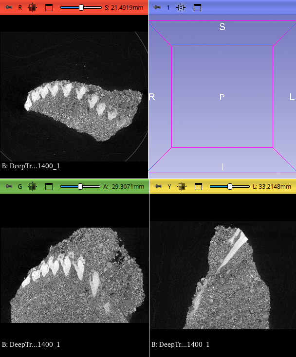

## MorphoDepot Repository
Repository for segmentation of a specimen scan.  See [this JSON file](MorphoDepotAccession.json) for specimen details.
* Species: Oncorhynchus rastrosus
* Accessioned specimen: UO F-92501
* Modality: Micro CT (or synchrotron)
* Contrast: Yes
* Dimensions: (1702, 1500, 550)
* Spacing (mm): (0.0390762, 0.0390762, 0.0781524)

## Screenshots

